# Autonomous Claw Bulldozer ROS 2 Workspace

An autonomous manipulation and earth-moving platform featuring a multi-axis articulating high-torque claw and bucket mechanism, 4WD skid-steer chassis, ESP32 dual-core real-time control, onboard IMU pose tracking, dual camera vision systems, and native ROS 2 Jazzy / micro-ROS integration.

> 📦 **Hardware Heritage & Lineage Notice:** Core electronics (ESP32 DevKitC, TC1508 H-bridge, GY-BMI160 6-DOF IMU, buck converters) and the baseline micro-ROS architecture were harvested and evolved from the decommissioned [Mihaii2/esp32_flipper_car](https://github.com/Mihaii2/esp32_flipper_car) (previously *esp32_bulldozer*).

<div align="center">
  <table>
    <tr>
      <td align="center" width="50%">
        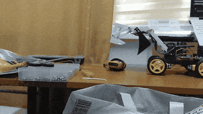<br/>
        <em>Rev 4: Original actuation demo: Synchronized lift, bucket articulation, and payload capture.</em>
      </td>
      <td align="center" width="50%">
        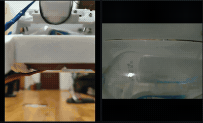<br/>
        <em>Rev 6: Field validation: Picking up objects.</em>
      </td>
    </tr>
  </table>
</div>

<br/>

<div align="center">
  <table>
    <tr>
      <td align="center" width="33%">
        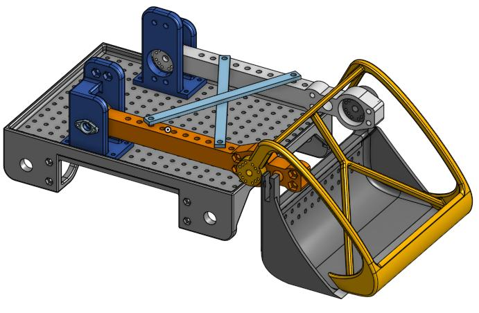<br/>
        <b>Revision 1: Organic Lattice</b><br/>
        <em>Continuous 3D round skeleton claw; discarded due to massive support waste and print cost.</em>
      </td>
      <td align="center" width="33%">
        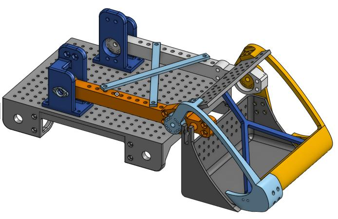<br/>
        <b>Revision 2: Split Axis Failure</b><br/>
        <em>Flat modular claw, but non-concentric pivot axes and horn bolt misalignments failed grip lock.</em>
      </td>
      <td align="center" width="33%">
        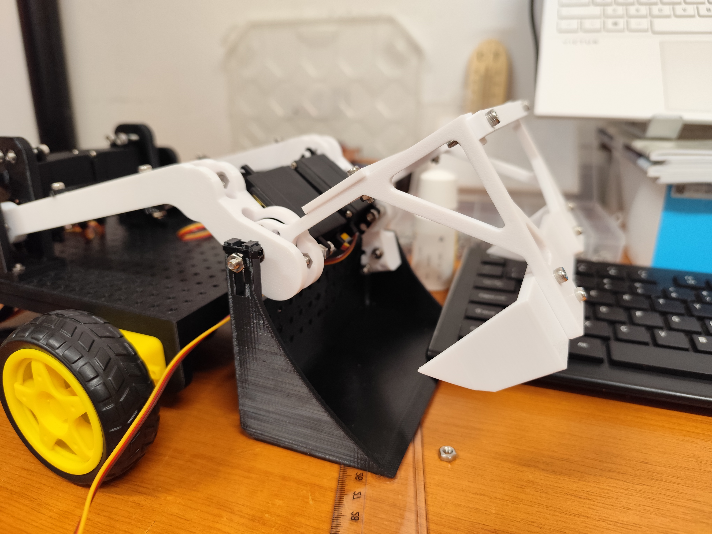<br/>
        <b>Revision 3: Compliant Beams</b><br/>
        <em>Concentric claw/cup axis resolved kinematics, but thin support arms caused excessive structural flex.</em>
      </td>
    </tr>
    <tr>
      <td align="center" width="33%">
        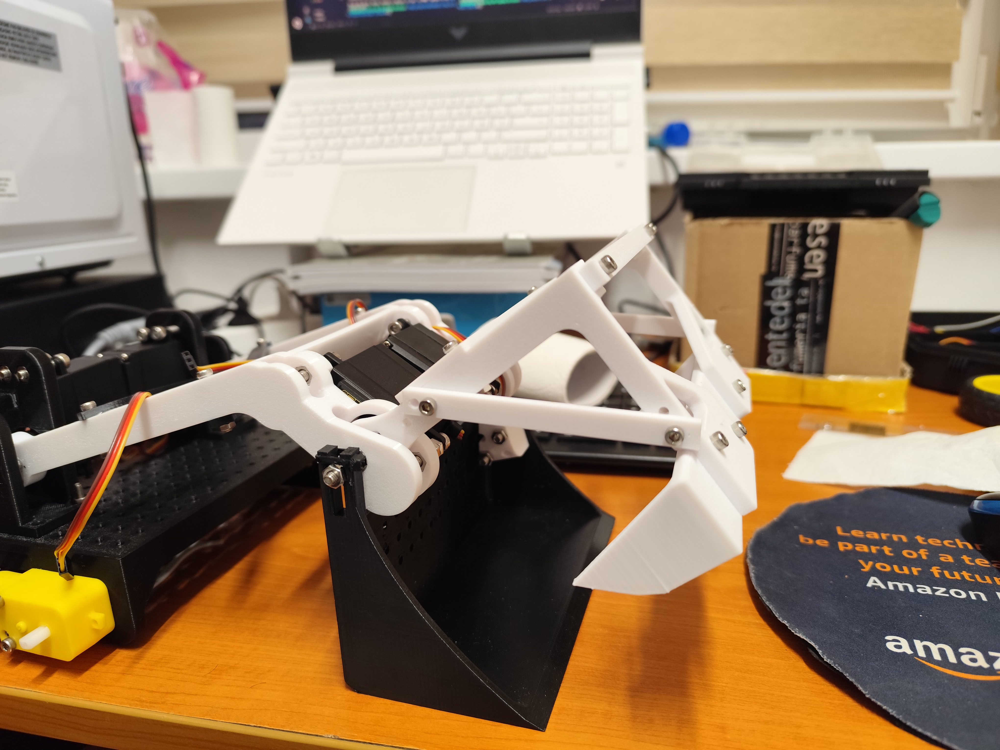<br/>
        <b>Revision 4: Rigid Production</b><br/>
        <em>Reinforced beam geometry; eliminated deflection and locked payload into the retention cup.</em>
      </td>
      <td align="center" width="33%">
        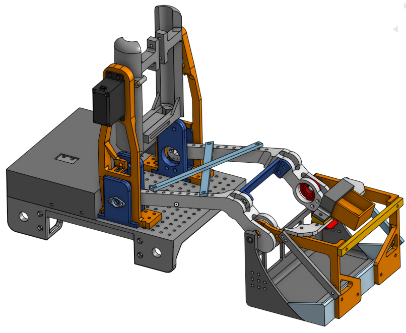<br/>
        <b>Revision 5: Dual Vision Rig</b><br/>
        <em>Beam-enclosed ESP32-CAM, 5th-servo phone tilter mast, and electronics protective cover.</em>
      </td>
      <td align="center" width="33%">
        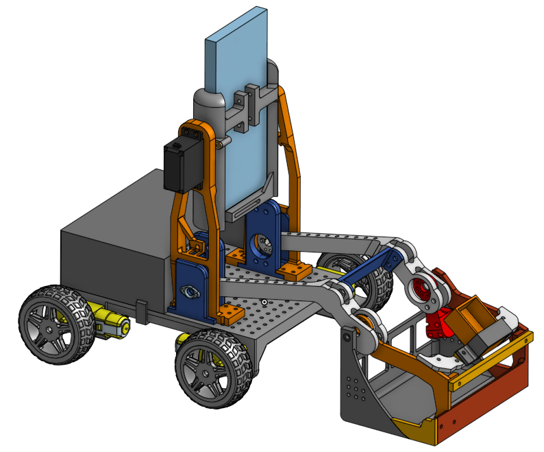<br/>
        <b>Revision 6: Vision & Overhead Clearance</b><br/>
        <em>Removed obstructing top beams, notched cup for direct camera line-of-sight, and retro-swing claw profile.</em>
      </td>
    </tr>
  </table>
</div>

---

## 🛠 Engineering Revision History & Post-Mortem Log

- **v1.0 (Organic Monolithic Claw):** Claw designed as a continuous 3D organic round skeleton. While lightweight on paper, slicer analysis proved it unviable for FDM printing: massive support structures consumed more filament than the part itself, driving print failure rates and material cost excessively high.
- **v2.0 (Modular Shell & The Pivot Misalignment Post-Mortem):** Redesigned the claw into flat-laying, easily printable structural components, as well as redesigning the chassis gussets to eliminate support waste. However, rapid CAD prototyping introduced two major mechanical flaws:
  - **Axial Offset:** The bucket/cup swing axis and the claw rotation axis were placed on disparate coordinate planes rather than a single concentric shaft. The mechanical offset degraded clamping reach, making object acquisition unreliable.
  - **Horn Geometry Error:** Servo horn mounting hole pitch and bolt clearances were mismeasured, preventing secure mechanical torque transfer without binding.
- **v3.0 (Concentric Axis & Structural Compliance Investigation):** Redesigned the mounting hub to align the cup and claw along a shared, concentric pivot axis. The mechanical geometry functioned correctly, but the claw extension beams were undersized in thickness. Clamping torque from the MG995 servos flexed the beams outward rather than transferring grip pressure into the target object.
- **v4.0 (Rigid Structural Reinforcement):** Completely re-engineered the claw support beams with increased cross-sectional area and internal ribbing. Flex was eliminated, permitting high-torque payload capture and retraction directly into the retention cup.
- **v4.1 (Locomotion Tuning & Track/Wheel Calibration):**
  - **Wheel Dimensional Scaling:** Replaced oversized 45mm-radius wheel collisions with realistic 20mm-radius (40mm diameter) hubs recessed directly into the chassis axle slots for accurate Gazebo physics and ground clearance.
  - **Pivot & Scrubbing Firmware Mitigation:** Tuned the differential drive turning profile across all speed gears to supply 100% PWM (255) to the outside wheels and 0% PWM to the inside wheels during turns, breaking lateral static friction without stalling the motors.
  - **Drivetrain Upgrade Roadmap:** Acquired **all-metal TT 1:90 6V reduction gearboxes** to replace the stock plastic units, delivering substantial low-end torque for heavy earth-moving without risk of gear-tooth shearing.
- **v5.0 (Perception Mast, 2S2P Power & Electronics Shielding):**
  - **Dual-Camera Convergence:** Enclosed secondary ESP32-CAM in a custom mount directly above the manipulation bay; added 5th MG995 servo on `GPIO 4` driving a tilt cradle for an operator smartphone.
  - **2S2P High-Current Battery Array (Brownout Mitigation):** In 2S1P, simultaneous 5-servo dynamic actuation and 4WD skid-steer scrubbing produced massive inductive rail sags, triggering ESP32 brownout detector resets (`rst:0x7 (TG0WDT_SYS_RESET)` / `Brownout detector was triggered`). Expanded to **2S2P (4× 18650)**, providing **20A instantaneous discharge headroom** at nominal 7.4V.
- **v5.1 (Hardware Failure Post-Mortem: Uncalibrated Mechanical Stall Burnout):**
  - **The Incident:** During a rushed bench test prior to implementing joint soft-limits in firmware, the smartphone tilt servo (`GPIO 4`) commanded an unverified absolute position. The smartphone cradle mechanically jammed against the upper structural bracing.
  - **The Consequence:** The servo's internal potentiometer hunted furiously around the unattainable deadband, causing the phone cradle to oscillate violently before pulling continuous stall current ($\approx 1.8\text{A}$ at 6V). The internal plastic/brass reduction gear cluster stripped, and the DC core motor suffered thermal commutator destruction.
  - **The Engineering Fix:** Implemented **dual protection**:
    1. **Dynamic Slew & Collision Soft-Limits:** Embedded piecewise polynomial clearance checks (`calc_smooth_phone_intervals`, `calc_smooth_claw_max`, `calc_smooth_cup_min`) directly in FreeRTOS to prevent conflicting joint trajectories.
    2. **Elastic Band Preload Damping (Backlash Elimination):** The cantilevered weight of the smartphone caused significant play around the MG995 output spline, allowing the cradle to wobble and flutter uncontrollably over small vibrations. To resolve this without machining custom friction clutches, high-tension elastic rubber bands were wrapped around the servo horn and anchored to the lower mount. The elastic bands apply constant downward tension to the horn, preloading the internal gear train, eliminating free play in the output spline, and providing mechanical resistance that dampens out oscillations.
- **v6.0 (Vision Line-of-Sight & Retro-Clearance Claw Redesign — Current Hardware):**
  - **Overhead Structural Beam Elimination:** The original crossbeams spanning the front chassis uprights introduced severe blind spots. The driver could not see whether an object was seated inside the collection cup. These beams were eliminated in CAD, redistributing torsional rigidity into the lower tub.
  - **Notched Vision Cup:** The solid retention bucket was completely remodeled with a chamfered center notch and lower rear sidewall. The onboard camera and phone tilt rig now maintain direct visual line-of-sight into the bottom of the cup.
  - **Overhead Clearance & Full Retro-Articulation Claw:** In the previous design, scooping under tall objects (such as bottles or vertical canisters) was impossible because the claw hung forward in front of the bucket opening; driving forward caused the claw to collide with the object's body before the cup lip could slide underneath. The claw geometry was re-engineered for expanded angular throw, allowing it to sweep higher up and swing entirely behind the rear profile of the cup when fully extended. This clears the approach path completely, allowing the cup to slide cleanly under tall items before the claw swings over the top to lock them in place.

---

## 🛠 Features

- **Articulated High-Torque Clamping:** 4× MG995 servos providing dual-arm lifting, cup tilting, and active payload grabbing.
- **Dynamic Perception Mast:** 5th MG995 servo driving an adjustable-pitch smartphone cradle alongside a dedicated, encased ESP32-CAM for dual-angle perception.
- **2S2P Anti-Brownout Power Bus:** 4× 18650 cell array supplying 20A continuous headroom at 7.4V, resolving previous ESP32 logic resets during high-strain claw and track maneuvers.
- **Reinforced M2-Bolted Backbone:** 4-piece perfboard array rigidly locked with M2 hardware, integrated with screw terminals and keyed JST-XH wiring harnesses for modular serviceability.
- **High-Gain RF Connectivity:** Dual 3dBi external antennas eliminating packet drop on high-bandwidth ROS 2 telemetry and camera streams.
- **Debris & Impact Shielding:** Custom 3D-printed electronics housing protecting motherboards, buck converters, and connections against soil fallout.
- **Fail-Safe Electrical Design:** Perfboard-soldered 5A car blade fuse, $4\times 1\,\text{k}\Omega$ MCU gate isolation resistors, and an aluminum thermal radiator preventing driver burnout.
- **Dual-Rail Isolated Power Distribution:** High-current XL4015 buck converter isolates heavy servo inductive back-EMF from the ESP32 logic rail.
- **Calibrated Skid-Steer Kinematics:** Asymmetrical 100/0 PWM steering regime breaks track scrubbing, supplemented by 20mm scale-matched wheel collisions.
- **Concentric Axis Kinematics:** Revision 4 unibody geometry maintains zero rotational shear between retention cup and claw swing arcs.
- **Native Micro-ROS Integration:** ESP32 communicates deterministic low-latency telemetry and joint states natively to ROS 2 Jazzy over XRCE-DDS.
- **Dual-Core FreeRTOS Execution:** Decoupled architecture isolating high-speed I2C sensor/PWM routines from network communication.

---

## 📐 Circuit Schematic

<div align="center">
  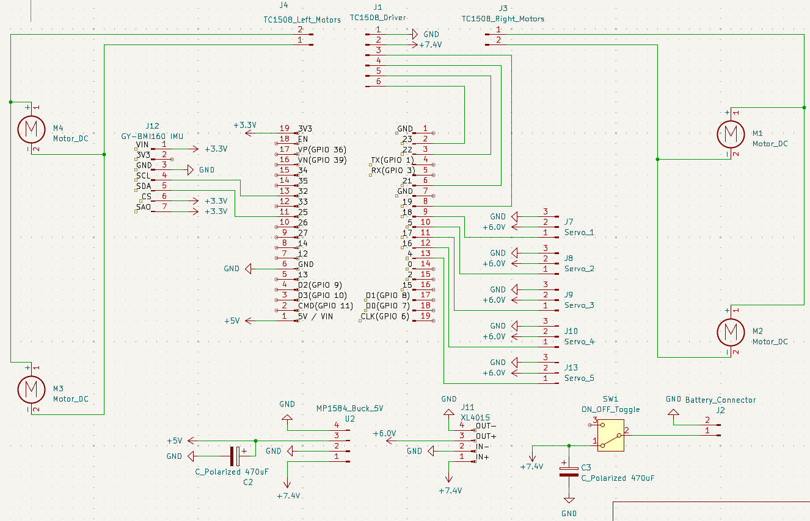<br/>
  <em>KiCad schematic detailing ESP32 pin mappings, sensor buses, power filtering, and motor/servo actuation stages.</em>
</div>

---

## 🖧 Custom Perfboard Motherboard & Hardware Protection

The primary motherboard is built on a modular composite deck created by joining **four 5cm × 7cm standard perfboards** mechanically using **M2 nuts and bolts**. This bolted multi-board array provides a rigid, vibration-resistant foundation for point-to-point power rails, sensor buses, RF transceivers, and fault isolation:

<div align="center">
  <table>
    <tr>
      <td align="center" width="50%">
        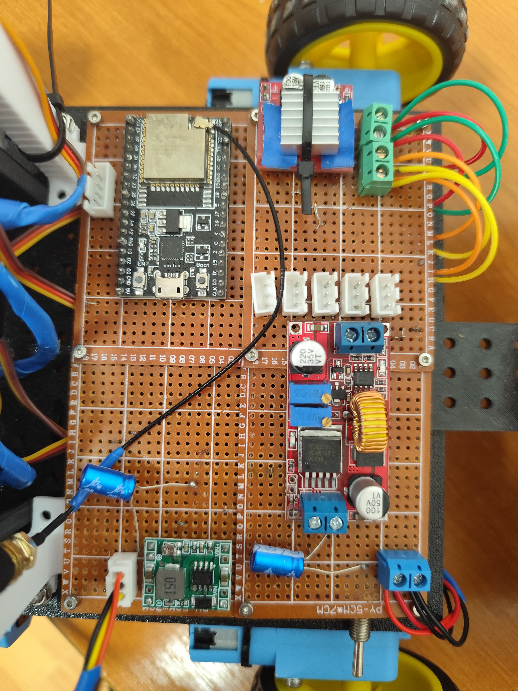<br/>
        <b>Component Plane (Top Side)</b><br/>
        <em>M2 bolted 4-tile perfboard array with ESP32 DevKit, MP1584EN & XL4015 bucks, heatsinked TC1508, screw terminals, JST-XH headers, 5A fuse, and servo bank.</em>
      </td>
      <td align="center" width="50%">
        <br/>
        <b>Trace & Solder Plane (Bottom Side)</b><br/>
        <em>Reinforced copper ground plane, point-to-point interconnect jumpers across the bolted boards, and logic decoupling.</em>
      </td>
    </tr>
  </table>
</div>

### Modular Wiring, Interconnects & Thermal Hardening
- **2S2P High-Current Bus Integration:** 4× 18650 cells wired in a 2-series 2-parallel configuration feed nominal 7.4V with 20A continuous discharge potential into the motherboard, fully eliminating inductive voltage dips and preventing the ESP32 from brownout resetting during heavy maneuvers.
- **Bolted Multi-Board Substrate (M2 Hardware):** Four individual 5cm × 7cm perfboards are mechanically fastened together with M2 nuts and bolts, forming a wide and rigid chassis electronics platform without fragile solder joints bridging structural seams.
- **Modular JST-XH Connectors:**
  - **IMU Interconnect:** Male JST-XH pin headers soldered directly to the perfboard carry the 3.3V logic/I2C lines to a mating female connector harness on the GY-BMI160 sensor.
  - **Auxiliary ESP32-CAM Power:** A dedicated perfboard-soldered male JST-XH connector delivers clean 5.0V logic rail power directly from the MP1584EN buck converter to the camera enclosure harness.
- **Screw Terminal Power & Motor Distribution:**
  - **Battery Bus:** 2× 2-pin PCB screw terminal blocks securely anchor the high-current 7.4V battery input and master return paths without relying on fragile jumper pins.
  - **DC Locomotion:** 4× 2-pin PCB screw terminal blocks connect the left and right drive motor leads directly to the TC1508 motor driver outputs.
- **Active Driver Heat Dissipation:** Under sustained skid-steer scrubbing, the TC1508 motor driver frequently entered internal thermal shutdown. An extruded aluminum heatsink/radiator was thermal-bonded to the IC package, eliminating thermal throttling during stall torque scenarios.
- **MCU Pin Isolation ($4\times 1\,\text{k}\Omega$ Resistors):** Dedicated $1\,\text{k}\Omega$ series current-limiting resistors were installed on every logic trace connecting the ESP32 GPIOs to the TC1508 inputs (`IN1`–`IN4`). If the H-bridge suffers catastrophic shoot-through or internal shorting to the motor supply rail, these resistors prevent high voltage from back-feeding and frying the ESP32 silicon.
- **5A Automotive Blade Fuse:** A standard 5A car blade fuse was soldered directly to the perfboard immediately downstream of the main power switch on the positive line feeding the TC1508 motor rail, isolating full-system shorts and protecting the battery pack from catastrophic damage.

---

## 🧩 Bill of Materials (BOM)

### Current Build (v6.0 Autonomous Dual-Vision Platform)

| Component / Module | Specification / Model | Qty | Description / Role |
|---|---|---|---|
| **Microcontroller** | ESP32 DevKitC V4 (SuooTci / USB) | 1 | Core logic, FreeRTOS tasks, PWM Generation, I2C IMU polling & Micro-ROS bridge |
| **RF Transceivers** | 2.4GHz 3dBi Omni Antennas | 2 | High-gain external antennas on U.FL/SMA pig-tails (1x DevKitC, 1x ESP32-CAM) |
| **IMU Sensor** | Bosch GY-BMI160 (6-DOF) | 1 | 3-axis gyro + 3-axis accelerometer for chassis orientation and terrain profiling |
| **Motor Driver** | TC1508 / MX1508 Dual H-Bridge | 1 | 4-channel DC driver ($2.0\text{V} - 9.6\text{V}$, $1.5\text{A}$ peak/ch) retrofitted with an extruded aluminum radiator |
| **DC Drive Motors** | TT Gearbox DC Motors (3V–9V) | 4 | Chassis locomotion (2x Left, 2x Right in parallel; *all-metal 1:90 6V reduction gearboxes purchased for swap*) |
| **High-Torque Servos** | TowerPro MG995 Metal-Gear | 5 | Actuation: Dual synced arm lift, bucket tilt, claw grip, and phone tilter mechanism |
| **Motherboard Substrate** | 5cm × 7cm Single-Sided Perfboards | 4 | Mechanically bolted together with M2 nuts & bolts into a unified composite deck |
| **Board Assembly Fasteners**| M2 Screws & Hex Nuts | Multi | Mechanical inter-board anchoring linking the four perfboards rigidly |
| **Logic Step-Down** | MP1584EN Buck Converter | 1 | Regulates 7.4V battery pack down to stable 5.0V for ESP32 VIN & ESP32-CAM |
| **Servo Step-Down** | XL4015 High-Current Buck Converter | 1 | High-capacity DC-DC step down (7.4V to 6.0V, $\ge 5\text{A}$) dedicated to MG995 servo array |
| **Logic Isolation** | $1\,\text{k}\Omega$ Resistors (Through-Hole) | 4 | Inline current-limiting protection on MCU-to-TC1508 logic control lines |
| **Circuit Fuse** | Standard Automotive Blade Fuse (5A) | 1 | Car blade fuse soldered directly to perfboard on the TC1508 7.4V battery input rail |
| **Signal Interconnects** | JST-XH 2.54mm Headers & Plugs | 2 | Motherboard male headers + wire plugs for modular IMU bus and ESP32-CAM 5V supply |
| **Power Interconnects** | 2-Pin Screw Terminal Blocks (5.08mm) | 6 | High-current connections (2x Battery bus input, 4x TT DC Motor outputs) |
| **Power Decoupling Caps**| $470\,\mu\text{F}$ Electrolytic ($\ge 16\text{V}$) | 2 | Inductive spike and brownout protection (1x on 7.4V battery rail, 1x on 5.0V logic rail) |
| **Main Battery Pack** | 18650 Li-ion Cells (2S2P / 7.4V Nominal) | 4 | High-discharge power source delivering up to 20A continuous at 7.4V to eliminate MCU resets |
| **Main Power Switch** | Mini 3-Pin SPDT Toggle Switch | 1 | Master battery circuit cutoff switch |
| **Electronics Shell** | 3D-Printed Top Bay Enclosure | 1 | Protective cover shielding motherboard, buck regulators, and wiring harness |
| **Secondary Vision** | ESP32-CAM in Custom 3D Enclosure | 1 | Close-proximity claw inspection; housed in a custom enclosure overcoming beam-mounting limits |
| **Primary Vision** | Articulated Smartphone Tilter Mount | 1 | Dynamic tilting mobile phone rig actuated via 5th MG995 servo on `GPIO 4` with elastic band preloading |
| **Depth Sensor (Roadmap)** | 8x8 Multizone ToF Matrix Sensor | 1 | Surface profiling and short-range claw docking validation |

---

### Legacy Hardware Donor: [Mihaii2/esp32_flipper_car](https://github.com/Mihaii2/esp32_flipper_car)

| Component / Module | Specification / Model | Qty | Status in Current Project |
|---|---|---|---|
| **Microcontroller** | ESP32 DevKitC V4 | 1 | **Migrated:** Re-flashed with manipulator kinematics and 5-channel servo control. |
| **Motor Driver** | TC1508 Dual H-Bridge | 1 | **Migrated:** Retained with aluminum heatsink and resistor isolation for chassis drive. |
| **DC Motors** | TT Gearbox DC Motors (3V–9V) | 4 | **Migrated:** Reused for chassis drive train (*all-metal 1:90 6V units already purchased for swap*). |
| **IMU Sensor** | Bosch GY-BMI160 (6-DOF) | 1 | **Migrated:** Shifted from balance control to kinematic leveling and terrain detection. |
| **Filter Capacitors** | $470\,\mu\text{F}$ Electrolytic ($\ge 16\text{V}$) | 2 | **Migrated:** Retained for dual-rail bus filtering. |
| **Buck Converter** | MP1584EN | 1 | **Migrated:** Retained as dedicated logic rail regulator. |
| **Tilt Switch** | SW-520D Ball Switch | 1 | **Deprecated:** Retired in favor of 6-DOF IMU telemetry. |
| **Dynamic Inversion Logic**| Auto-Flip Firmware Controller | — | **Deprecated:** Replaced by kinematic trajectory control for arm and bucket. |

---

## 📹 Hardware Calibration

<div align="center">
  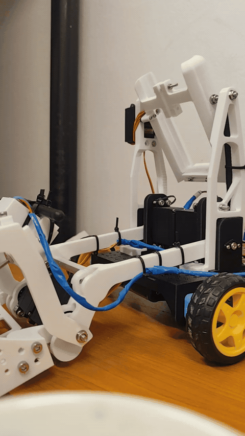<br/>
  <em>Bench test: Manually determining physical interference angles between the camera mast, lift arms, and retention cup.</em>
</div>

The video above shows the result of the manual step-by-step physical calibration procedure used to map the robot's mechanical boundaries. Before committing firmware soft-limits, each servo channel was actuated incrementally to identify exact collision points:
- **Example:** Raising the arms beyond $70\%$ elevation causes the cross-brace to clip the phone cradle if tilted between $115^\circ$ and $145^\circ$.

---

## 📶 Network Routing Evolution & Infrastructure Architecture

### 1. The Wide-Area Cellular Vision (Vodafone vs. Orange Reality Check)
The initial architectural goal was ambitious: liberate the robot from local Wi-Fi range entirely. By mounting a smartphone with mobile data onto the robot and pairing the laptop to fixed institutional Wi-Fi, the vehicle was envisioned to operate anywhere within citywide cellular coverage:
- **The Vodafone Bottleneck:** Initial testing in this geographic sector failed immediately due to severe upstream bandwidth throttling on Vodafone. Video frames dropped continuously, and keepalive packets routinely timed out, tripping the firmware safety watchdog (`DRIVE_TIMEOUT_US = 160000`) and stalling the motors mid-maneuver.
- **The Orange Bandwidth vs. Latency Paradox:** Switched to an Orange SIM card. Upstream and downstream bandwidth improved dramatically, but packet round-trip times (RTT) were erratic. Cellular carrier routing, tower switching, and bufferbloat introduced massive latency jitter (spiking unpredictably between $120\text{ ms}$ and $600\text{ ms}$). While adequate for passive video streaming, driving a skid-steer bulldozer and controlling an open-loop articulated claw with fluctuating half-second input lag proved completely uncontrollable.

### 2. The Netis Dual-Band Router & The Eduroam Channel 48 Wall
To eliminate carrier jitter, the strategy shifted to establishing a private, high-speed local wireless network using an affordable **Netis dual-band router** (providing simultaneous 2.4 GHz for the ESP32 and 5 GHz for high-throughput video streaming from the phone):
- **The Channel 48 Scanning Failure:** The primary campus network (*eduroam*) operated on **5 GHz Channel 48**. The budget Netis router's wireless repeater/bridge firmware was incapable of properly locking onto or decoding the upstream eduroam 5 GHz Channel 48 broadcast. Because the router could not repeat the network wirelessly, the entire setup was stranded without internet access or direct upstream bridge connectivity.

### 3. The Wired Ethernet Bridging Solution
The networking roadblock was solved by re-architecting the laptop as the primary gateway:
1. **Upstream Link:** The laptop's internal wireless card maintains the upstream connection to the campus network (eduroam on Channel 48).
2. **Physical Ethernet Bridge:** A dedicated Ethernet cable connects the laptop’s RJ45 port directly to the Netis router's uplink port, bridging internet and local network traffic.
3. **Isolated Dual-Band Subnet (`10.42.0.0/24`):**
   - The Netis router broadcasts an isolated, high-speed local subnet (`SSID: Project`).
   - The **ESP32 DevKitC** connects cleanly to the **2.4 GHz b/g/n** band (locked to Channel 6, 20 MHz bandwidth, zero power saving).
   - The **operator smartphone** connects to the **5 GHz** band for video telemetry.
   - All teleoperation commands, micro-ROS UDP packets, and WebSockets route directly across the local switch without entering campus or cellular infrastructure, maintaining deterministic sub-25ms response times.

---

## ⚡ Communication Protocol Benchmark: HTTP vs. WebSockets

Teleoperation requires sustained bidirectional round-trip times (RTT) under $50\text{ ms}$ to maintain fine balance and grab payloads without crushing or overshooting.

<div align="center">
  <table>
    <tr>
      <td align="center" width="50%">
        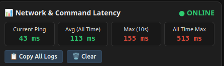<br/>
        <b>Legacy HTTP / REST Polling Architecture</b><br/>
        <em>High connection teardown overhead: 113ms average latency, peaking to 513ms all-time max.</em>
      </td>
      <td align="center" width="50%">
        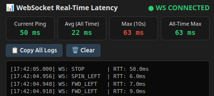<br/>
        <b>High-Speed WebSocket Full-Duplex Architecture</b><br/>
        <em>Persistent TCP socket: 22ms average latency, capped at 63ms all-time max. Sub-10ms drive frames.</em>
      </td>
    </tr>
  </table>
</div>

### Empirical Performance Comparison

| Metric | Legacy HTTP / REST Teleop | WebSocket Duplex Teleop (Current) | Improvement Factor |
|---|---|---|---|
| **Underlying Transport** | Stateless HTTP GET/POST polling | Persistent Bidirectional WebSocket (`ws://`) | Persistent connection / No TCP handshakes |
| **Current Live Ping** | $43\text{ ms}$ | **$16\text{ ms} - 50\text{ ms}$** | $\approx 2.5\times \text{ faster}$ |
| **All-Time Average RTT** | $113\text{ ms}$ | **$22\text{ ms} - 28\text{ ms}$** | **$4.5\times - 5.1\times \text{ lower latency}$** |
| **Peak 10s Latency** | $155\text{ ms}$ | **$63\text{ ms}$** | **$2.5\times \text{ lower jitter}$** |
| **All-Time Max Spike** | **$513\text{ ms}$ (Severe Lag)** | **$63\text{ ms}$ (Deterministic)** | **$8.1\times \text{ stability headroom}$** |
| **Drive Packet Processing** | Request parsing, headers overhead | Raw frame tags (`C:FWD_LEFT`, `C:STOP`) | Instantaneous frame dispatch ($1\text{ ms} - 9\text{ ms}$) |

---

## 🎛 Web-Based Hardware Teleoperation & Calibration Dashboard

To bypass ROS 2 workstation boot delays during field tests, the ESP32 serves an embedded, real-time dashboard written in vanilla JS/CSS directly over WebSockets (`ws_handler` on port 80).

<div align="center">
  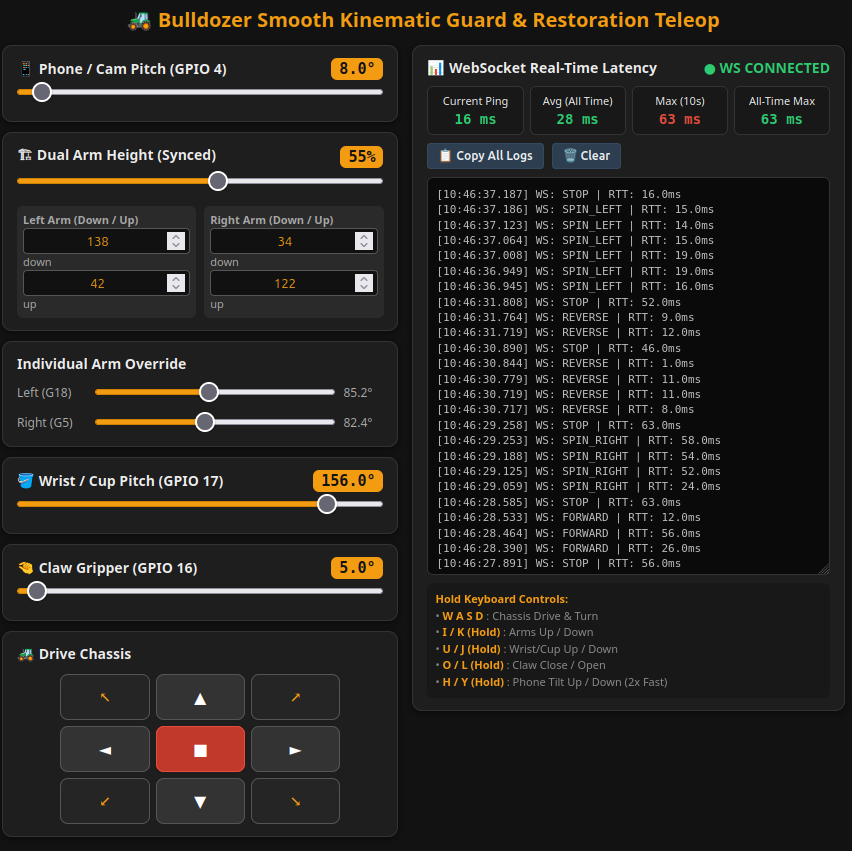<br/>
  <em>Integrated real-time teleoperation GUI featuring live feedback badges, calibration overrides, drive controls, and latency diagnostics.</em>
</div>

### Dashboard Capabilities & Safety Pipeline:
1. **Kinematic Angle & Elevation Monitoring:** Displays calibrated servo readouts for Camera Pitch (`GPIO 4`), Synced Dual-Arm Height (`GPIO 18` / `GPIO 5`), Wrist/Cup Pitch (`GPIO 17`), and Claw Gripper (`GPIO 16`).
2. **On-the-Fly Hardware Calibration:** Numeric step fields allow instant adjustment of mechanical arm endpoints (`cal_l_down`, `cal_l_up`, `cal_r_down`, `cal_r_up`) over the air without re-flashing ESP32 firmware.
3. **Continuous Smooth Safety Governor:**
   - Claw opening limits are smoothly coordinated relative to arm lift percentage (`calc_smooth_claw_max`) to keep mechanisms within dynamic structural boundaries.
   - Cup tilt is dynamically elevated when the arm approaches the chassis floor (`calc_smooth_cup_min`) to prevent under-chassis binding.
   - Phone tilt angle is restricted if the arms raise past $70\%$ elevation (`calc_smooth_phone_intervals`) to prevent the lift mechanism from colliding with the camera mast.
4. **Sub-10ms Drive Interface:** 8-direction tactile buttons and a dedicated emergency stop (`■`) paired with continuous keyboard polling (`W A S D`) sending short frame descriptors (`C:FORWARD`, `C:SPIN_LEFT`, `C:FWD_RIGHT`).

---

## ⚡ ESP32 Firmware Pinout Reference

Unified GPIO allocation across motor drive stages, servo PWM channels, and sensor buses:

| Subsystem | Component Pin | ESP32 GPIO / Rail | Peripheral / Channel | Function / Operational Limits |
|---|---|---|---|---|
| **DC Drive (TC1508)** | `IN1` | `GPIO 23` | `LEDC_CHANNEL_5` via $1\,\text{k}\Omega$ Resistor | Right Track Motor (Direction A) |
| **DC Drive (TC1508)** | `IN2` | `GPIO 22` | `LEDC_CHANNEL_6` via $1\,\text{k}\Omega$ Resistor | Right Track Motor (Direction B) |
| **DC Drive (TC1508)** | `IN3` | `GPIO 21` | `LEDC_CHANNEL_7` via $1\,\text{k}\Omega$ Resistor | Left Track Motor (Direction A) |
| **DC Drive (TC1508)** | `IN4` | `GPIO 19` | GPIO Output via $1\,\text{k}\Omega$ Resistor | Left Track Motor (Direction B - Inverted Rail) |
| **Servos (MG995)** | Phone Tilter | `GPIO 4` | `LEDC_CHANNEL_0` | Actuated Camera / Phone Pitch (`0.0°` to `180.0°`) |
| **Servos (MG995)** | Arm Base Left | `GPIO 18` | `LEDC_CHANNEL_1` | `138.0°` (Down / 0%) to `42.0°` (Up / 100%) |
| **Servos (MG995)** | Arm Base Right | `GPIO 5` | `LEDC_CHANNEL_2` | `34.0°` (Down / 0%) to `122.0°` (Up / 100%) *(Mirrored)* |
| **Servos (MG995)** | Cup / Wrist Tilt | `GPIO 17` | `LEDC_CHANNEL_3` | High-Torque Retention Cup Pitch Control |
| **Servos (MG995)** | Claw Gripper | `GPIO 16` | `LEDC_CHANNEL_4` | Extended Retro-Clearance Claw Sweep Control |
| **IMU (BMI160)** | `SCL` | `GPIO 32` | `I2C_NUM_0` SCL via JST-XH | Hardware I2C Clock Line |
| **IMU (BMI160)** | `SDA` | `GPIO 25` | `I2C_NUM_0` SDA via JST-XH | Hardware I2C Data Line |
| **IMU (BMI160)** | `CS` / `SA0` | `3.3V Rail` | Logic High via JST-XH | Sets I2C Address to `0x69` |

> *Note: All MG995 servos utilize `LEDC_TIMER_0` configured for 50 Hz PWM with 14-bit resolution.*

---

## 🔌 Hardware Power Architecture & Wiring Topology

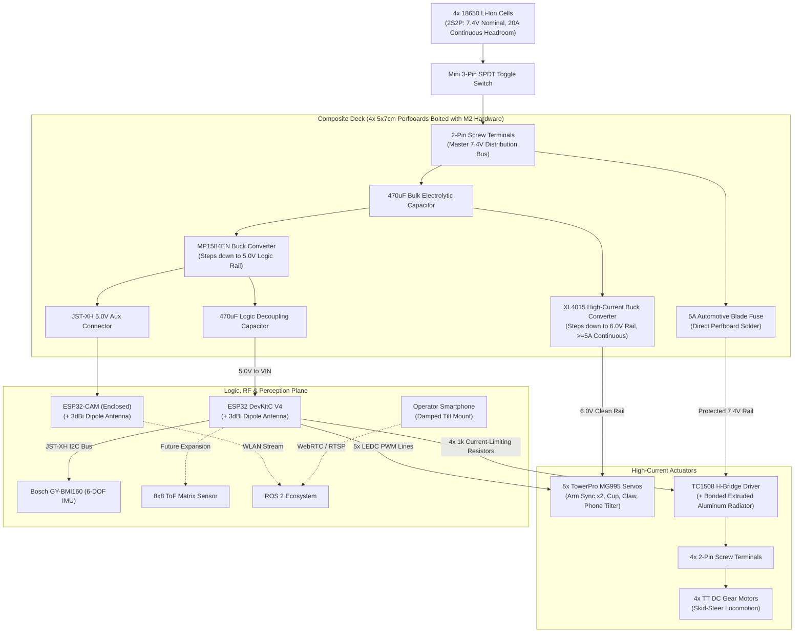

---

## 📝 Engineering Retrospective & Teleoperation Reality Check

> ### ⚠️ Teleoperation Usability Assessment & Thesis Retrospective
> *In robotics prototyping, there is often a substantial gap between clean CAD kinematics and real-world manipulation. Below is an honest engineering evaluation of current platform limitations:*
> 
> 1. **The Skid-Steer Alignment Battle:** Driving the chassis into position to acquire small payloads (e.g., picking up an uneven item like a slipper) remains frustrating and imprecise. Due to skid-steer scrubbing dynamics, small directional adjustments cause the chassis to either stick against floor friction or snap beyond the target. The open-loop TT gear motors lack encoder feedback, requiring continuous, fatiguing operator micro-corrections.
> 2. **Visual Parallax and Spatial Disconnect:** Even with dual cameras, the phone tilt mast, and the redesigned vision cup, judging millimeter clearances between the claw tips, the payload, and the ground surface is difficult through a 2D video stream. The operator lacks depth perception and frequently closes the claw either too early (clamping air) or too late (pushing the payload out of reach).
> 3. **Absence of Haptic / Current Feedback:** The TowerPro MG995 servos operate in pure open loop without stall current or torque sensing. The operator cannot "feel" how securely an object is captured. Brittle payloads can be easily crushed, or uneven payloads can slip out without the operator realizing it until the arm is fully retracted.
> 4. **Mechanical Play vs. High Inertia:** Accelerating a mobile phone cantilevered high above the chassis creates significant mechanical torque on the tilt pivot. Despite adding mechanical damping and firmware slew control, sudden chassis stops still cause minor shudder in the video feed.
> 
> *Conclusion:* While the vehicle demonstrates that high-torque earthmoving, multi-joint articulation, and reliable low-latency teleoperation are achievable with affordable commercial-off-the-shelf hardware, smooth payload capture requires significant operator patience. Future revisions will consider **closed-loop wheel odometry**, **current-sensing servo feedback**, and **automated depth-based grasping routines** to alleviate operator cognitive load.

---

## 🚀 Quick Start Guide

### Prerequisites
- Ubuntu 22.04 / 24.04 LTS
- ROS 2 Jazzy Jalisco / Humble Hawksbill
- ESP-IDF v5.2+
- Docker Engine (for micro-ROS Agent daemon)

```bash
# 1. Build and Source ROS 2 Workspace
cd ~/ROS_projects/claw_bulldozer_ws
colcon build --symlink-install
source install/setup.bash

# 2. Flash Real-Time ESP32 Firmware
. $HOME/esp/esp-idf/export.sh
cd ~/ROS_projects/claw_bulldozer_ws/firmware/flipper_firmware
idf.py build flash monitor

# 3. Start micro-ROS UDP Agent (Terminal 2)
docker run -it --rm --net=host microros/micro-ros-agent:jazzy udp4 --port 8888

# 4. Access Standalone Calibration & Teleop Web Dashboard
# Connect to the local router network ("Project") and navigate to:
http://10.42.0.x/
```